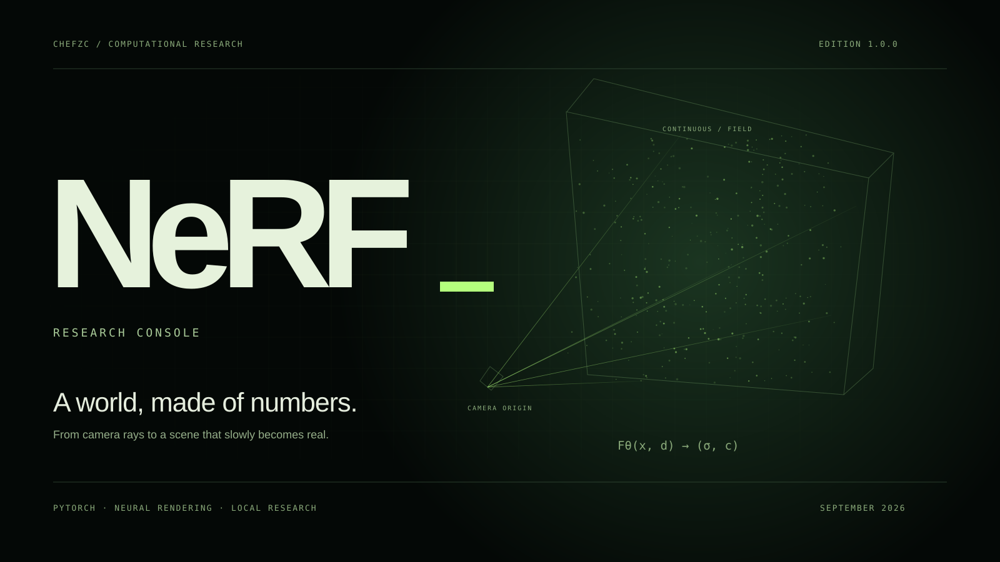

# ChefZC — Digital space

**English** · [简体中文](README.zh-CN.md)

A personal website for the things I love and make. **Current 2.1** turns the whole space into one river: indigo night water, mist, and a living current of colour. Every real project keeps its own visual language, from a midnight basketball court and a cosmic manuscript to a violet botanical atelier.

[**Enter my space ↗**](https://chefzc.dev) · [Gallery](https://chefzc.dev/gallery.html) · [Posts](https://chefzc.dev/posts.html) · [Now](https://chefzc.dev/now.html) · [Game](https://chefzc.dev/game.html)

## Current 2.1 / Everything in flow · Website 2.0

A full redesign of every room. The homepage opens on a live streamline field: thousands of currents part around 川流不息 and around your cursor (exact potential flow past a cylinder; hold to stir), then the page runs downstream through ten chapters — 源 Source, 信 Creed, 我 Self, 爱 Passion, 声 Sound, 器 Tools, 途 Journey, 作 Works, 遇 Hello, 归 Return. Every long page ends at the same river.

- Palette: night-river indigo `#0b0d26`, mist `#e7ebf2`, and a six-colour current used only as strokes and marks.
- Type: Adobe Fonts kit `per8hkf` — HelloFont ChunHei (heavy, wide modern Chinese display), HelloFont JueJiangHei (Chinese reading), Cesso (Latin display); DM Sans and IBM Plex Mono stay self-hosted. The Noto Sans SC fallback subset now includes every character on the site (川 was missing before).
- New mark: 川, written as three currents.
- Motion: one shared clock, paused off-screen, in background tabs, by the site-wide switch and by reduced motion; cross-page view transitions.
- Design system: [`DESIGN.md`](DESIGN.md); product context: [`PRODUCT.md`](PRODUCT.md). Previous shell files are archived in `design/before-current-20261009/`.

## Pulse / Claude joins the observatory

Pulse now counts Anthropic models alongside GPT, in real time. The same local collector reads Claude Code session transcripts (`~/.claude/projects`, including the desktop app's Code tab and subagents), counts each assistant message once, and publishes only hourly numeric aggregates. Claude cache writes are priced separately as 5-minute (1.25× input) and 1-hour (2×) writes, cache reads at each model's rate. [Details](docs/usage-observatory.md).

## AC8 / A living battlespace · Website 1.27.1

The sky keeps moving: real contour-path deformation, bounded incoming photographic aircraft stickers, automatically tracking missile stickers and fan-shaped countermeasure bursts. One visible-only clock drives every loop and supports pause/resume and reduced motion. The new transparent missile and flare assets are AI-generated artwork; these fictional formations are separate from the unchanged, real Steam log.

## AC8 / The other sky · Website 1.27

ACE COMBAT 8 joins the Game Room with an authentic JSF F-35C silhouette, original vector contours, a white-edged Tasha cosplay sticker cut out non-generatively with Adobe, and interruptible illustrated missile trails. Steam aggregates synchronize from a read-only, AC8-only Windows bridge; playtime is never invented between Steam writes. The bridge starts at the current user's Windows login and retains the last record offline.

[Flight exhibit](https://chefzc.dev/game.html#ace-combat-8) · [Public aggregates](https://chefzc.dev/api/ac8-record)

## NABAT / INJAZ · Website 1.25

NABAT 1.1 joins the School Lab as my INJAZ business competition project. Its ivory and botanical-green exhibit connects identity, living history and native operations, with four actual software screens and interruptible motion. A new Now milestone and bilingual botanical note share the same visual identity.

[School exhibit](https://chefzc.dev/school-gallery.html#project-nabat) · [Now 027](https://chefzc.dev/now.html#milestone-nabat) · [Botanical note](https://chefzc.dev/post.html?article=nabat) · [Source repository](https://github.com/ChefDavid0815/nabat-injaz)

## Everything in Flow / Flow Edition · Website 1.24

8 October 2026: the personal website has a new look. Profile, Gallery, Now, Posts and the Flow Index share one continuous route. Reading and imagery have more room, while each exhibit retains its own type, colour and material. The release adds Now milestone **026** and bilingual note **015**, preserving all earlier work and records.

[New homepage](https://chefzc.dev/profile.html) · [Release milestone](https://chefzc.dev/now.html#milestone-everything-in-flow) · [Design note](https://chefzc.dev/post.html?article=everything-in-flow) · [Flow Index](https://chefzc.dev/explore.html)

## DOT/AIR 1.1 / Orbital Earth · Website 1.26

<a href="https://chefzc.dev/gallery.html#project-dot-air"></a>

DOT/AIR replaces the retired AER exhibit. Its own vermilion, polka dots and wide type frame a real rotating sphere with 19,717 geographic samples. The edition drawer follows 1.1 → 0.1 with actual native horizon and theoretical-route captures. Now 029 records the 1.1 update, Now 028 the first exhibit, and bilingual note 017 tells the story. Live flight inventory and ticketing remain unavailable.

[Exhibit](https://chefzc.dev/gallery.html#project-dot-air) · [Edition log](https://chefzc.dev/gallery.html#dot-air-history) · [Now 029](https://chefzc.dev/now.html#milestone-dot-air-11) · [Departure note](https://chefzc.dev/post.html?article=dot-air)

## NeRF 1.0 / A world, made of numbers.

The School Lab opens a dedicated computational specimen for **NeRF Research Console**: layered camera rays, restrained phosphor light, a floating recorded reconstruction and a short progressive reveal. Its project space follows six transformations from input views to a rendered scene. A real checkpoint time machine and three saved test cameras sit beside a clearly scoped evidence ledger. The newest Now entry retains the timeline's original structure and embeds a small neural-renderer window; the fourteenth bilingual Post has its own computational editorial layout.

[Enter the field](https://chefzc.dev/nerf.html) · [School exhibit](https://chefzc.dev/school-gallery.html#project-nerf) · [Research log](https://chefzc.dev/post.html?article=nerf) · [Now 024](https://chefzc.dev/now.html#milestone-nerf) · [Source / EN + 中文](https://github.com/ChefDavid0815/nerf-research-console).

[](https://chefzc.dev/nerf.html)

The software runs locally with PyTorch, FastAPI, React and an Electron Windows shell. Published imagery and CSVs come from an actual 50,000-step **256-ray** Lego continuation; the evaluated view sets are specified. Spatial particles are editorial diagrams, and the website starts no training. No full-dataset benchmark or completed encoding-bandwidth study is claimed. [Design, evidence and verification](docs/nerf-exhibition.md).

## Roseraie 0.1 / A little grace in every great idea.

The eighth—and first—main exhibit opens a pale rose-and-lavender Rococo atelier inside the site's dark digital shell. Original SVG filigree, drifting petals, an animated cameo and a layered **actual Windows screenshot** frame three switchable plates: the real desktop salon, an editorial illustration of the three-pass Weave, and a real file-approval test capture. The Now miniature and the eleventh bilingual Post share its paper, typography and ornament. Motion obeys the site's pause control and reduced-motion setting.

[Explore the exhibit](https://chefzc.dev/gallery.html#project-roseraie) · [Read the atelier journal](https://chefzc.dev/post.html?article=roseraie) · [Now 017](https://chefzc.dev/now.html#milestone-roseraie) · [Source and bilingual documentation](https://github.com/ChefDavid0815/roseraie-agent) · [Windows 0.1.0](https://github.com/ChefDavid0815/roseraie-agent/releases/tag/v0.1.0).

Roseraie is a local-first desktop agent; the portfolio is an exhibition, not a browser version of its native file and command tools. Its unsigned first release passed 12 tests, a build and basic Windows checks, including one controlled Codex CLI repair. Other provider presets and environments need further verification.

## Atlas 0.3 / Above every idea, a wider universe.

The seventh main exhibit opens with Atlas 0.3, an independent IB learning observatory. Its real 0.3 Renaissance fresco and cosmic pigment art frame an interactive three-view cabinet: a living star chart, a manuscript and a subject index. Procedural stars, orbit light, GSAP scroll choreography and tactile controls echo the app while keeping the site's dark digital shell. [Open Atlas](https://chefzc.dev/atlas/) on this domain, [explore the gallery](https://chefzc.dev/gallery.html#project-atlas), read the [bilingual field notes](https://chefzc.dev/post.html?article=atlas), or follow [Now milestone 016](https://chefzc.dev/now.html#milestone-atlas).

The exhibit uses the existing site language switch. Chinese display and reading type are locally hosted subsets of Zhuque Fangsong and LXGW WenKai GB; the English companion is EB Garamond. The source app and website copy are included in the subsets' CJK coverage. Atlas is an editorial study map, not an official or exhaustive IB syllabus. [Source / EN + 中文](https://github.com/ChefDavid0815/atlas-diploma-observatory).

## Atelier 1.22 / CHROMA — every bit, in color.

**CHROMA 0.1.0 · Signal Remix** has a dedicated exhibit with the app’s electric blue, yellow, signal red, cyan, pixel lettering and chrome instrument frames. A floating monitor, rotating burst stars, moving signal traces, reflective metal and raised keys form an interactive Y2K installation. CPU / GPU / RAM controls change its colour and feature perspective. Three actual interface views show Simple, PRO and the desktop mini window; the PRO screenshot follows the selected language. The artwork never reads a visitor’s hardware.

Now **015 / 2026-09-22** has a matching instrument miniature. The ninth bilingual Post, **A little colour for the heartbeat of a computer**, covers the design, local monitoring and honest measurement limits. Animations share the site’s motion control and reduced-motion preference; the site’s dark shell and all previous project identities are retained.

[Windows early access](https://github.com/ChefDavid0815/chroma-monitor/releases/tag/v0.1.0) · [Exhibition](https://chefzc.dev/gallery.html#project-chroma) · [Post](https://chefzc.dev/post.html?article=chroma) · [Now](https://chefzc.dev/now.html#milestone-chroma). [Publication checks](docs/verification-1.22.md).

## Atelier 1.21 / Festival Toolkit 0.3 — the journey update.

The third Festival Pass adds an original paper journal, an animated compass and seven woven colour bands, keeping the pale mint, sky blue and pink identity. The exhibition introduces 38 categories and 2,833 entries, wristband ownership and daily GitHub release checks. Four real 0.3 screenshots and three public release entries are available in the detail window.

Now milestone **014 / 2026-09-22** has its own matching miniature. No new Post was added; the original 0.1.1 article stays historical. The site and profile documentation are bilingual. [Download 0.3.0](https://github.com/ChefDavid0815/horizon-festival-toolkit/releases/tag/v0.3.0) · [Now](https://chefzc.dev/now.html#milestone-festival03).

## Atelier 1.20 / ProjectLens — look closer.

ProjectLens 0.1.0 joins the main collection with a real procedural 3D optical instrument, graphite/mint/ice-blue materials and three interactive feature perspectives. The same visual identity appears in a new bilingual article and the newest Now milestone. Its source and unsigned Windows release are on [GitHub](https://github.com/ChefDavid0815/projectlens). The app supports Chinese and English, system-language detection and a saved local preference; scan messages and exports follow that choice. Screenshots in the exhibit and article match the website language. Local directory scanning requires the desktop app; the exhibit does not read visitor files.

## Atelier 1.19 / Objects, light & living sleeves

A real-time iridescent 3D sculpture for the profile, sculptural room entrances, an exhibition guide, layered paper and glass, woodland light, a chronological editorial journal, and a shared typographic finale. Each project keeps its own palette and materials. NBA 2K27 now has thick glass neon tubes, metal sockets, colored spill and a slow spectrum cycle. [Explore the game room](https://chefzc.dev/game.html#nba-2k27).

The record shelf adds an **animated cover theatre** using original QQ Music artwork: directed light, mist, ripples, dust and fine moving textures. The two favourite albums have dedicated treatments. These are procedural visual studies, not official animated covers, generated walking performances, or music videos. Artwork stays available when WebGL is unavailable. All animations follow the shared motion preference, pause offscreen, and stop in hidden tabs. The profile sculpture loads only when needed; its render rate is capped, as are cover animations. [Visual system and implementation](docs/atelier-design.md).

## Pulse / Usage observatory

A unified glass navigation, richer materials, calmer reading rhythm and shared motion controls, with every project retaining its own art direction. New [Pulse observatory](https://chefzc.dev/usage.html): today, 7 days, 30 days and locally recorded lifetime tokens, stacked bars, model distribution and an API-price equivalent. Only numeric aggregates are uploaded. New usage records trigger cloud sync and server events update the page. Precise counts follow model-call usage reports; there is no simulated per-token counter. Offline collectors retain clearly dated records. [Accounting and sync](docs/usage-observatory.md) · [Design and motion](docs/atelier-design.md)

## Game room / Life in play

The [Game page](https://chefzc.dev/game.html) now has three exhibits: F1 25 as a bright pop-art 2026 grid with authentic Ferrari SF-26, McLaren MCL40 and Mercedes W17 imagery and official team marks; FH6 in lime, cobalt and pink with Tokyo pop art; NBA 2K27 in a glass cover sleeve with animated RGB court lighting. The F1 car focus, three FH6 scenes, three NBA lighting looks, motion controls and bilingual copy are interactive. F1 playtime and save metadata come from a dated, read-only Steam snapshot; FH6 collection counts remain explicitly historical. [Data provenance and offline refresh](docs/game-room.md).

## The collection

| Page | Inside |
| :--- | :--- |
| **Personal Profile** | ChefZC, a Year 12 IB student at GEMS Wellington International School in Dubai. Basketball, motorsport, AI, art, devices, milestones and public contact links. Only the city is shown as a location. |
| **Gallery** | Nine real projects: DOT/AIR 1.1, Roseraie 0.2.0, Atlas 0.3, CHROMA 0.1.0, ProjectLens 0.1.0, Festival Toolkit 0.3.0, AXIOM 1.0, Folio 1.1 and NBA After Hours. Independent visual identities, project dialogs, source and download/play links. |
| **3D collection** | Two independent works: Chase Center (switchable interior/exterior cases) and a Curry head study. Real, draggable glass cases with free modeling downloads. |
| **School Lab** | NeRF Research Console and WIS TECH TANK · STRIDE. Independent computational and woodland exhibitions, project/source links and research journals. |
| **Now** | Twenty-four milestones, newest first. NeRF publication on 30 September 2026, with research beginning on 24 September. |
| **Posts** | Seventeen bilingual notes, newest first. A computational research log for NeRF, alongside AFTERIMAGE and earlier project journals. |

`index.html` redirects to `profile.html`, retaining the query and fragment. Navigation, language preference and footer are shared. The first visit follows the system language (Chinese or English); the **中 / EN** switch translates navigation, copy, dialogs and page titles. Preference persists when local storage is available and synchronises across same-origin tabs. Brand names and decorative artwork retain their original design.

## WIS TECH TANK / A separate school lab

[STRIDE](https://chefzc.dev/stride/) is a bilingual classroom environment simulator. The **Personal collection / School lab** navigation separates the main personal projects from school work. The school page keeps the site's dark shell and uses forest green, warm paper, an original woodland artwork, drifting light, sensing rings and a field-book scene selector. Three exhibition illustrations explain pavement, stairs and uncertainty; the actual app offers nine scenarios. The exhibit is not a live sensor feed.

Motion can be paused and respects `prefers-reduced-motion`; the screenshot dialog supports Escape and restores focus. Chinese/English switching preserves the selected exhibit scene. The Now milestone and sixth Post share the natural art direction. `wis-content.js`, `wis-exhibit.js`, `wis-post.js`, `school-gallery.js` and `wis.css` contain the feature. [Artwork provenance and generation prompt](dist/assets/projects/wis-tech-tank/ARTWORK.md).

## Folio 1.1 — a new page

The exhibition uses cream paper, terracotta, serif type, layered sheets and subtle hover motion. An expandable **version journal** shows 1.1 and 1.0, release dates, changes and their respective downloads. It works with the keyboard, stays open when switching language, and can be linked directly at `gallery.html#folio-history`.

Three 1.1 screenshots show the in-app journal, FH6 collection and Nexus reading room. **FH6 uses controlled samples; Nexus works, authors and covers in the screenshot are test fixtures, not live listings.** They are actual UI captures, stored under `dist/assets/projects/folio/v1.1/`. Original 1.0 screenshots and the September 17 launch article remain historical records.

Folio's local file operations require its Windows app. Nexus personal API key support is implemented, but app registration is incomplete, SSO is unavailable, and live accounts/downloads and in-game compatibility are unverified. [Folio documentation](https://github.com/ChefDavid0815/folio-mod-studio).

## NBA After Hours

[Play in the browser](https://chefzc.dev/play/nba-after-hours/) or inspect the [separate source repository](https://github.com/ChefDavid0815/nba-after-hours). `dist/play/nba-after-hours/` is a static release snapshot with `release.json` and dependency licences. It needs no backend or API. Saves belong to the current browser and do not automatically sync with desktop copies.

To update: build the game in its source directory, then run `node scripts/import-game.mjs "path-to-game-source"` here. Inspect and deploy the resulting snapshot. Screenshots are under `dist/assets/projects/nba-after-hours/`; exhibition styles live in `gallery-court.css`.

## A personal record shelf

The music section has **9 artists, 84 selected songs**, real portraits/album covers and two favourite albums: Joker Xue's《守村人》and Jay Chou's《七里香》. Jay Chou, Joker Xue, G.E.M., David Tao, Eason Chan, Vae Xu, Jane Zhang and JJ Lin have ten selections each; Menni has《哀人 (i)》《抑人 (e)》《巴拉莱卡（The Rod）》and《没有了 (The End)》. Official song titles and collaboration credits are preserved.

Covers rotate every 12 seconds within the selected artist or all songs. Hover, keyboard focus, hidden tabs and an open player pause rotation. Reduced-motion preference disables automatic rotation by default. Search, filtering, paging, manual next/previous and shuffle are available; changing the displayed card does not replace an open player.

The optional player loads QQ Music's official iframe only after a click. Playback needs its own official controls and is subject to login, membership, licensing and region. An official song link is offered if loading fails. **Successful embedded playback has not been verified.** The site does not read login state, cookies, passwords or membership credentials, sync private playlists, or host audio. Closing removes the iframe.

Music metadata and 71 local images have a source manifest at `dist/assets/music/sources.json`. Images belong to their respective rights holders and do not inherit the sports-photo Creative Commons licences. `scripts/import-music.mjs` imports an already verified local manifest; it does not run private search APIs in visitors' browsers.

## Run locally

Requires Node.js. No dependency installation or compilation is needed for this static site.

```powershell
git clone https://github.com/ChefDavid0815/personal-homepage.git
cd personal-homepage
npm run dev       # http://127.0.0.1:4173
npm run check     # JavaScript syntax checks
```

`dist/` is the complete website. `vercel.json` runs `npm run check` and deploys that directory. The website version **1.23.0** is separate from Folio's **1.1.0**.

## Maintain the space

| Files | Purpose |
| :--- | :--- |
| `dist/projects.js` | Real project list; tags, source/play links and per-language overrides. Count is generated from the list. |
| `dist/folio-releases.js` | Folio current version, immutable dates and bilingual history; newest first. |
| `dist/folio-exhibit.js`, `folio-content.js`, `gallery-folio.css`, `folio-history.css` | Folio exhibition, screenshots, translations and journal. |
| `dist/gallery.js`, `gallery.css`, `gallery.html` | Gallery rendering, native project dialog and layout. |
| `dist/posts-data.js`, `posts.js`, `posts.css` | Article data, reading interaction and art direction. Unknown article IDs show a return link. |
| `dist/profile.html`, `profile.css`, `personal-content.js`, `personal.js`, `personal.css` | Profile, interests, devices, contact and email-copy feedback. Copying does not send email. |
| `dist/now.html`, `now.css` | Timeline. Add a unique heading ID, update count/date and provide both languages. Dates record events, not visit dates. |
| `dist/i18n.js`, `language.css` | Language selection, translations and responsive bilingual typography. |
| `dist/music-data.js`, `music-content.js`, `music.js`, `music.css` | Music catalogue, bilingual copy, interactions and design. |
| `dist/styles.css`, `motion.js` | Shared design, scroll reveals and subtle pointer tilt. Touch disables tilt; reduced motion is respected. |

Keep new projects real and link their actual source or playable/downloadable release. Add `translations.zh` and `translations.en` for public copy. The three old placeholder projects have been removed. Existing artwork may retain its original language. Content remains readable without decorative animation.

## Credits

ChefZC is the display name; GitHub: [ChefDavid0815](https://github.com/ChefDavid0815), Instagram: [chefzichuan](https://www.instagram.com/chefzichuan/), public email: [zzichuan0808@outlook.com](mailto:zzichuan0808@outlook.com).

Sports photographs retain their attribution and CC BY-SA terms in `dist/assets/PHOTO-CREDITS.md`. Music imagery has separate rights and source records. Lucide and Tabler icon licences are included. The original hero asterisk was generated for this site. Folio's Cormorant Garamond font is local with its OFL licence; the core Space Grotesk, DM Sans, IBM Plex Mono and Noto Sans SC families are now self-hosted with OFL licences and a source/hash manifest. Game metadata, covers, names and marks belong to their respective rights holders.


## AXIOM · 格物 / Scientific plotting

[Open AXIOM / 打开网页版](https://chefzc.dev/axiom/) · [Source / 源码](https://github.com/ChefDavid0815/axiom-studio)

A dedicated cold-white, ink, lime and cobalt exhibition uses real application imagery and the bundled Hooke’s-law dataset. The Now timeline adds milestone 008, with a matching experiment window. Content supports Chinese and English. Maintain the exhibition in `axiom-exhibit.js`, `axiom-content.js` and `axiom.css`.


## Festival Toolkit 0.2 / Website 1.15

[Exhibition](https://chefzc.dev/gallery.html#project-festival-toolkit) · [Version journal](https://chefzc.dev/gallery.html#festival-history) · [Windows release](https://github.com/ChefDavid0815/horizon-festival-toolkit/releases/tag/v0.2.0)

The original mint, sky-blue and pink Festival Pass now introduces 647 car models and an updatable content catalogue. A perforated ticket archive opens to public releases 0.2.0 and 0.1.1, with dates, bilingual changes and separate downloads. The detail dialog switches between actual 0.2.0 playlist and garage captures. Changing language preserves the selected screenshot, season palette and open journals.

Now milestone 011 records this release with a matching 647-model pass. The September 18 launch entry and 0.1.1 Post remain historical. Native disclosure controls support keyboard interaction; motion respects reduced-motion preferences. Main projects and the separate School Lab remain intact.

Maintain `festival-releases.js` for versions and links, `festival-content.js` for translations, `festival-exhibit.js` for markup, and `festival.css` / `festival-history.css` for the artwork. See the asset `SOURCES.md` for capture provenance. The app is Windows-only; encrypted saves use a third-party online service, and in-game effects remain unverified.

## Courtside collection / Website 1.16

`models-gallery.html` sits beside the main and school collections. Chase Center and Curry are independent works; the arena switches between interior and exterior glass cases. Three.js 0.180 loads actual Draco GLBs, with rotate, pause, reset and zoom controls. Rendering pauses offscreen/in background. Reduced motion disables automatic rotation; actual model renders remain available if WebGL or loading fails.

Now adds milestone 012. The seventh bilingual Post shares the glass artwork. All Posts now use a single-column chronological index: descending date, then descending issue number for same-day entries. The companion GitHub libraries are [NBA Arena Models](https://github.com/ChefDavid0815/nba-arena-models) and [NBA Player Models](https://github.com/ChefDavid0815/nba-player-models).

Browser display copies have simplified materials and seating; the native assets, import evidence and limitations are documented in their repositories. No reference library is published. See [artwork provenance](dist/assets/models/ARTWORK.md).

The checked-in viewer bundle works without a build. To modify `scripts/model-viewer.js`, run `npm ci`, `npm run build:models`, and `npm run check`. Build dependencies are pinned; Vercel continues to serve `dist`.

The Courtside **Pop Edition** uses cobalt, yellow and hot pink, comic halftones, offset printing shadows and collectible-card layouts across the 3D exhibition, Now and its journal entry. Motion includes floating artwork, a moving type strip, scroll reveals, pointer parallax and a small 3D basketball. The motion switch pauses decorative animation and turntables; reduced-motion preferences start with motion paused.
